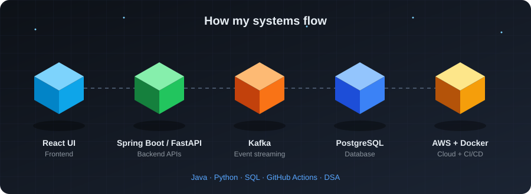
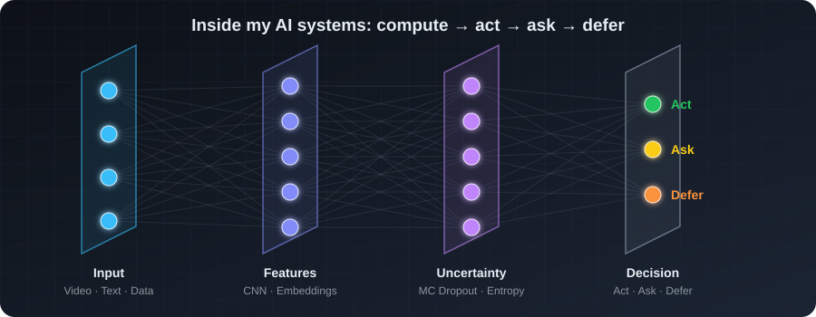
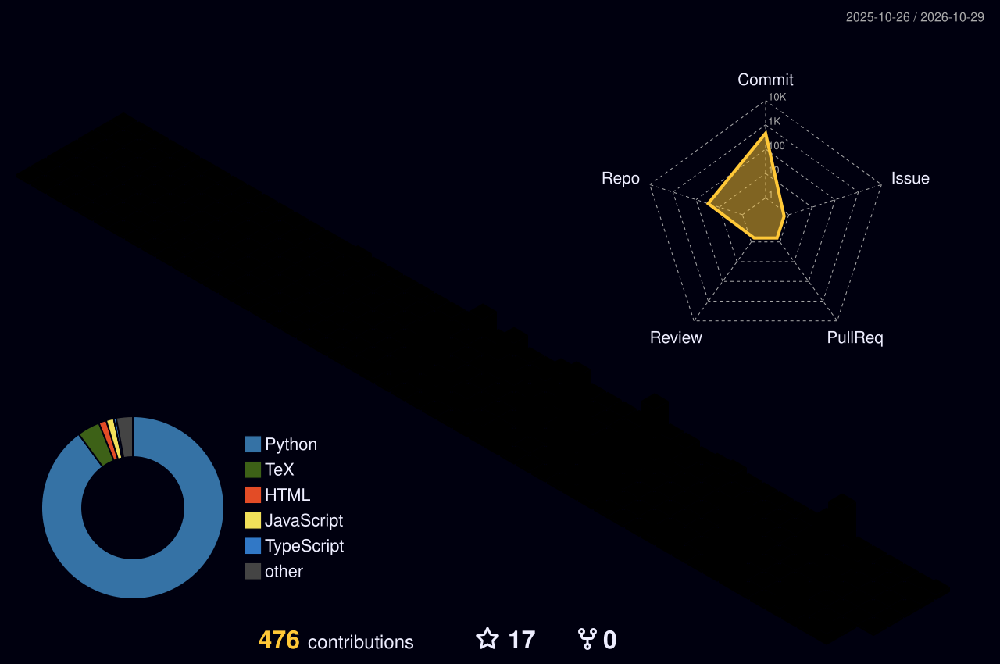

# Hi, I'm Asmitha M 👋

### AI/ML Engineer | Data Scientist | Data Engineer

I build **AI and data systems that make better decisions under uncertainty** — from efficient video understanding and uncertainty-aware decision layers to backend services and scalable data pipelines.

> **I’m interested in one question: when should an intelligent system compute, act, ask, or defer?**

---

## 🏗️ How My Systems Flow

<div align="center">
  
</div>

---

## 🧠 How My AI Systems Decide

<div align="center">
  

  **[▶ Open the interactive 3D version (drag to rotate)](https://asmitha2025.github.io/3d-lab/)**
</div>

---

## 📊 My 3D Contribution Graph

<div align="center">
  
</div>

---

## About Me

🎓 **B.Sc. Data Science** — Bon Secours College for Women, Bharathidasan University  
**CGPA:** 9.3/10

🎓 **M.Sc. Data Science** — SASTRA Deemed University  
Part-time, weekends

💻 **Systems & Automation Platform Intern — Scion R&D**  
Built backend validation services using REST APIs, processing and validating **50,000+ records across 6 validation layers** during a 6-month internship.

🤖 **Independent AI Researcher & Open-Source Developer**

🏆 **Team Lead — Meta PyTorch OpenEnv Hackathon 2026**  
Worked on **IncidentMind**, an OpenEnv-based incident-response environment, alongside team members.

🏁 Participated in innovation challenges including **Microsoft Imagine Cup, UIDAI Hackathon, and Zoho Cliq Developer Contest**.

---

## What I Build

### 🤖 AI & Machine Learning

I build systems around **uncertainty, decision-making, computer vision, NLP, and efficient inference**.

My focus is not only on making models work, but on understanding **when a model should act and when it should not**.

### ⚙️ Software Engineering

I build backend services, REST APIs, data-intensive applications, and engineering workflows with an emphasis on reliability, testing, and maintainability.

### 📊 Data Engineering

I design data pipelines, validation systems, ETL workflows, data models, and analytics-ready infrastructure.

---

## Featured Projects

### 🚀 frameroute

**CPU-first, change-aware frame selection for Video AI**

An open-source Python/PyPI library that decides **which video frames are worth sending to expensive vision models**.

- CPU-based visual-change detection
- Streaming frame-selection router
- MCP server
- CLIP / OCR / Whisper integrations
- 38 test files
- Processed **46 of 40,984 frames** in one 23-minute lecture at ~120 FPS CPU
- At equal model calls, matched or beat uniform sampling on **4/4 lectures** in retrieval testing
- Achieved **67–74% fewer calls** than every-frame processing on two lectures

The goal: **spend compute where the visual information actually changes.**

---

### 🧠 SupportMind

**Uncertainty-aware decision layer for AI systems**

SupportMind uses model uncertainty and competing-intent detection to decide whether a system should:

**Act → Ask → Defer**

It combines MC Dropout, entropy-based uncertainty, multi-intent detection, FastAPI, and CI workflows.

On an out-of-distribution evaluation, the system achieved **100% precision on the cases it chose to act on**, while maintaining a conservative decision boundary.

---

### 🎥 ADVE — Anchor-Delta Video Embedding

A training-free approach for reducing redundant visual encoding.

Instead of running CLIP on every frame, ADVE processes selected anchor frames and approximates intermediate representations from tracked visual changes.

- **60% fewer model calls** on MOT17
- **0.992 cosine similarity**
- **65% lower GPU memory**
- **62.6% savings** on a 13-category CCTV evaluation at 0.995 similarity

Research publication: **Zenodo 20748839**

---

### 🛡️ LLM Sentinel Pro

A semantic safety checker designed to identify potentially unsafe chatbot responses.

- 9-layer semantic checking pipeline
- **82% accuracy**
- **100% recall**
- **73.5% precision**
- Processed **5,000 answers in ~12 seconds on CPU**

The project also revealed a **40% false-positive rate** on a small evaluation set, which is an important limitation I continue to investigate.

---

### ⚡ OPTI-FAB

**Streaming edge inference for wafer-defect detection**

- Reduced latency from **8.3 ms → 3.0 ms**
- **63.9% latency reduction**
- **333 FPS**
- TensorRT FP16: **0.79 ms**
- **91% full-frame accuracy**

An early-exit experiment reduced accuracy substantially, providing a useful engineering trade-off finding.

---

### 🚦 PTIS v2.0

A Bayesian traffic-intelligence system combining **destination inference with a capacity safety gate**.

Simulation results:

- **8,000 vehicles**
- **23,314 observations**
- **0 gate violations**

Current results are simulation-based and have not yet been field-tested.

---

### 🔥 IncidentMind

An **OpenEnv reinforcement-learning environment for production incident response**.

It includes:

- 9 incident scenarios
- Deterministic evaluation
- Clarification actions
- Structured incident-response workflows

Built as a team project during the **Meta PyTorch OpenEnv Hackathon 2026**.

---

## Technical Interests

- Artificial Intelligence & Machine Learning
- Computer Vision
- NLP & LLM Systems
- Bayesian Inference
- Uncertainty Quantification
- AI Safety & Reliability
- Backend Engineering
- Data Engineering
- Efficient Model Inference
- DevSecOps & Cloud Security
- Research Engineering

---

## Tech Stack

**Languages**  
Python · SQL · Java · JavaScript

**Backend & APIs**  
FastAPI · REST APIs · Spring Boot

**Data Engineering**  
PostgreSQL · ETL Pipelines · Data Validation · Data Modeling · PySpark · Power BI

**AI / ML**  
PyTorch · TensorFlow · Scikit-learn · NLP · Computer Vision · LLM Workflows

**Infrastructure & DevOps**  
Docker · Linux · Git · GitHub Actions · AWS

**Currently Exploring**  
Dialogflow CX · IAM · DevSecOps · Secure Routing · SRE · Reliable AI Systems

---

## My Engineering Philosophy

I don't want AI systems to simply produce an answer.

I want them to understand:

```
Should I compute?
        ↓
Should I act?
        ↓
Should I ask?
        ↓
Should I defer?
```

---

## Connect With Me

🌐 **Portfolio:** [asmitha2025.github.io](https://asmitha2025.github.io)

💼 **LinkedIn:** [asmitha-m-1695b331b](https://www.linkedin.com/in/asmitha-m-1695b331b)

🤗 **Hugging Face:** [Asmitha-28](https://huggingface.co/Asmitha-28)

📧 **Email:** [asmitha8825@gmail.com](mailto:asmitha8825@gmail.com)

---

*Always building, always questioning, always learning how systems behave when the real world gets messy.*
